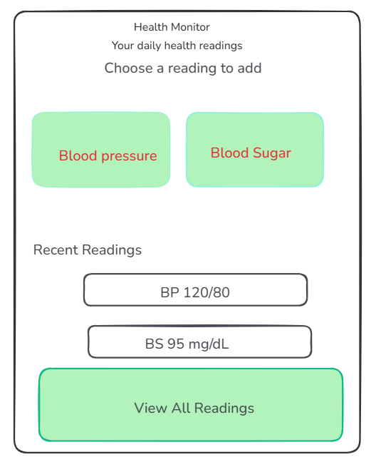

# Health Monitor 
Take control of your daily health readings, one record at a time.

Health Monitor is a simple and user-friendly web application designed to help individuals record, track, and manage their daily health measurements. It provides a convenient way to store blood pressure and blood sugar readings, review previous records, and monitor changes over time.

## Wireframe

## Target user
Individuals who want a simple and convenient way to monitor their daily health measurements and maintain a personal record of their readings.

## Features to include
1. Record Readings – Enter and save daily blood pressure and blood sugar measurements.
2. View Reading History – Access previously saved health records.
3. Update and Delete Readings – Edit existing records or remove readings when necessary.
4. Search Readings – Find specific health records by measurement type or value.
5. Track Health Trends – Filter readings by date range to review changes over time.
